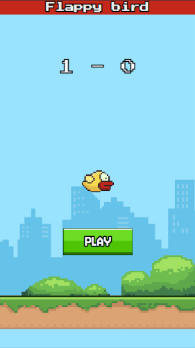
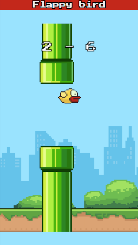

# Canvas Game — Flappy Bird

A simple Flappy Bird-style game built with Canvas, CSS, and JavaScript.

Grab as many coins as you can and avoid the walls (pipes).

## Stack

- JavaScript, js modules
- HTML5 Canvas
- Tailwind 4
- CSS

## Live Demo

- [Play Now](https://linxfather.github.io/game_js_flappy_bird/game4.html)

## Screenshots

## How to Play

- Desktop
  - Left mouse click or `Space` key
- Mobile
  - Tap the screen

## How to run the game locally

- download or clone repository
- install [nodejs](https://nodejs.org/en/download)
- run commands (set-up local http-server)
  - npm i -g http-server
  - cd game_js_flappy_bird
  - http-server
- open `http://127.0.0.1:8080/game4.html`

## License
- [MIT](LICENSE.md)